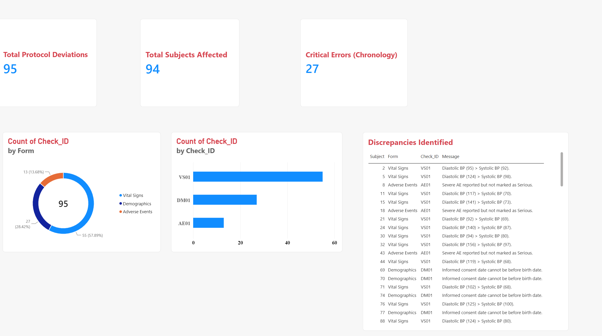

# 🚀 Clinical Data Validation Engine & Quality Dashboard

Welcome to my Clinical Data Management portfolio project! 

In clinical trials, data quality isn't just about clean spreadsheets—it's about patient safety and regulatory compliance (FDA/ICH-GCP). If a hospital site makes a critical data entry error, the clinical team needs to know immediately. This project was born out of a desire to modernize how we track those errors, moving away from manual Excel reviews and toward a fully automated, programmatic pipeline.

## 🎯 Project Aims
* **Automate Discrepancy Detection:** Build a Python engine that programmatically identifies logical and clinical errors in raw trial data.
* **Simulate Real-World Infrastructure:** Stage the data in a relational SQL database to mimic a live Electronic Data Capture (EDC) backend.
* **Bridge the Gap to Operations:** Create an interactive Business Intelligence dashboard that translates raw error logs into actionable insights for Clinical Data Managers and Medical Monitors.

## 🛠️ Technology Stack
* **Core Logic:** Python (Pandas, SQLAlchemy, NumPy, Faker)
* **Database Backend:** PostgreSQL (pgAdmin 4)
* **Visual Analytics:** Power BI
* **Clinical Standards:** CDISC principles (DM, VS, AE domains)

## ⚙️ Steps Executed

### Phase 1: Data Generation & Staging (The EDC Backend)
To make this as realistic as possible, I couldn't just use a static CSV. I wrote a Python script (`generate_large_data.py`) to generate complex synthetic clinical data for 500 patients across three domains: Demographics, Vital Signs, and Adverse Events. This script opens a secure connection and injects the data directly into a local **PostgreSQL** database (`clinical_staging` schema), acting as our mock EDC system.

### Phase 2: The Validation Engine (Python Edit Checks)
Next, I built the core logic engine (`run_validation.py`). This script queries the live PostgreSQL database and runs the data through strict, hardcoded edit checks. I designed these checks to catch real-world clinical violations:
* **DM01 (Critical Compliance):** Flags patients whose Informed Consent date is recorded *before* their Date of Birth.
* **VS01 (Logical Error):** Flags instances where Systolic blood pressure is recorded as lower than Diastolic blood pressure.
* **AE01 (Clinical Mismatch):** Flags Adverse Events marked with a "Severe" intensity, but incorrectly marked "No" for Seriousness.

### Phase 3: Visual Analytics (The CDM Dashboard)
A massive CSV file of errors is hard to read. To make the data actionable, I connected **Power BI** directly to the validation engine's output. I designed a 3-tier layout featuring a top-level KPI strip for instant trial health assessment, middle-tier charts to find the root cause of errors (by form and rule), and a bottom-tier dynamic table to serve as the Data Manager's daily action list.

## 📈 Results
The validation engine successfully extracted the raw database tables, processed the logic, and identified exactly **95 protocol deviations**. 

Through the Power BI dashboard, I was able to instantly isolate the most critical violations—specifically the DM01 Chronology errors. Instead of hunting through hundreds of rows of data, a Data Manager using this tool can simply click the "DM01" filter and immediately export the exact list of subject IDs to query the offending hospital sites.

## 💡 Conclusion
This project demonstrates that modern Clinical Data Management requires more than just clinical knowledge; it requires technical data engineering. By integrating Python, PostgreSQL, and Power BI, we can transform a manual, error-prone data cleaning process into a highly automated, visually intuitive pipeline. This drastically reduces the time required for data review, accelerating the path to database lock.

---

## 📊 Dashboard Preview
*(This dashboard dynamically filters the discrepancy action list based on the selected KPIs and forms).*

## 🚀 How to Run Locally
1. **Database:** Install PostgreSQL and create a database named `clinical_db`.
2. **Environment:** Run `pip install pandas sqlalchemy psycopg2-binary numpy faker`.
3. **Execute:** Update the local credentials in the Python scripts. Run `generate_large_data.py` to stage the database, followed by `run_validation.py` to generate the query report.
4. **Visualize:** Open `CDM_Query_Dashboard.pbix` in Power BI to view the live dashboard.